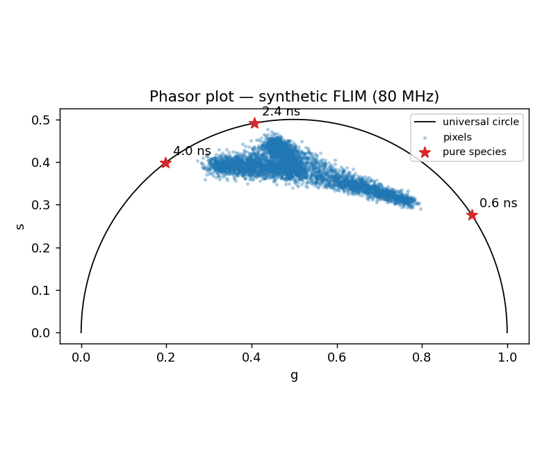
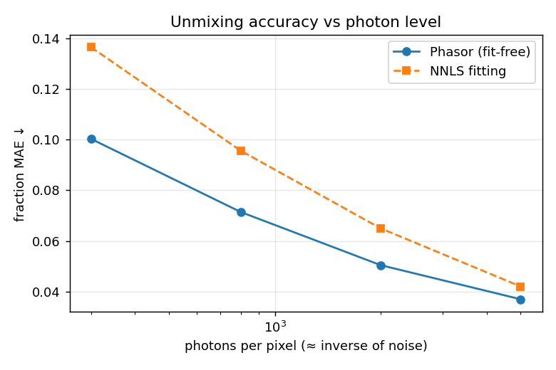

# 🔬 Phasor FLIM Explorer

> **Fit-free phasor analysis** of FLIM (Fluorescence Lifetime Imaging Microscopy) data: phasor transform, graphical unmixing of species and a quantitative comparison with classical exponential fitting, all on synthetic data with ground truth, runnable without a GPU.



## What it shows

The **phasor approach** maps each fluorescence decay to a point `(g, s)` on the phasor plane through a single sine/cosine pair, **with no nonlinear fitting**. A mono-exponential decay falls on the *universal circle*; a mixture of species falls on the linear combination of their phasors, weighted by the photon fractions. This makes **unmixing** (how much of each species is present in each pixel) a linear problem that is fast and robust to the photon-counting noise typical of FLIM.

The project compares the phasor approach with **decay fitting** (NNLS on the full curve) using the same prior information, so the comparison isolates the advantage of the *method*.

## Pipeline

```
synth  →  phasor  →  unmix  →  metrics
  │         │          │          │
  │         │          │          └─ MAE vs ground truth
  │         │          └─ per-pixel fractions (linear, fit-free)
  │         └─ (g, s) maps + universal circle
  └─ synthetic K-species FLIM with known fractions + Poisson noise
            ▲
            └─ baseline: NNLS decay fitting (comparison)
```

## Dataset

**Synthetic, generated locally** (`scripts/download_data.py` → `make_synthetic_flim`): mixtures of K fluorophores with known lifetimes (default 0.6 / 2.4 / 4.0 ns at 80 MHz), spatial fraction maps as ground truth and realistic Poisson noise. The pipeline is designed to also accept real FLIM data (`H×W×T` stacks).

> It can be extended to real public FLIM data by replacing the loader; the expected format is an `(H, W, T)` stack plus the time axis and the laser frequency.

## Data and licenses

- No third-party data are used or redistributed.
- All FLIM data are synthetic, generated by `src/phasor_flim/synth.py` with known ground truth (fraction maps and lifetimes).
- The synthetic data are covered by the same MIT license as the code (see `LICENSE`).

## How to run (uv)

```bash
uv sync --extra dev
uv run pytest -q                         # correctness tests (phasor + unmixing)
uv run python scripts/evaluate.py        # writes metrics and figures to results/
uv run streamlit run app/main.py         # interactive explorer
```

## Results (synthetic data)

`scripts/evaluate.py` compares phasor unmixing with NNLS fitting on the MAE of the
fractions, as a function of the number of photons (noise level). Full metrics and
figures are in `results/` (`metrics.json`, `phasor_plot.png`, `mae_vs_photons.png`).

**Fraction MAE ↓** (3 species, 80 MHz, Poisson noise):

| Photons/pixel | Phasor (fit-free) | NNLS fitting |
|-------------:|:-----------------:|:------------:|
| 300  | **0.100** | 0.136 |
| 800  | **0.071** | 0.096 |
| 2000 | **0.050** | 0.065 |
| 5000 | **0.037** | 0.042 |

The phasor approach is more accurate at **every** noise level and is on average **~23× faster** than NNLS fitting (wall-clock on CPU, machine-dependent), while using the same prior information (the reference lifetimes).



## Methodological notes and limitations

- The **reference lifetimes** are assumed known (for both the phasor approach and the fitting): a fair comparison that isolates the method, not the information.
- Real data require **instrument calibration** (IRF) and harmonic correction; here the synthetic data are already calibrated.
- Linear unmixing assumes a superposition of discrete components; species with continuous lifetime distributions require additional models.

## References

- Digman M.A. et al., *The Phasor Approach to Fluorescence Lifetime Imaging Analysis*, Biophysical Journal 94(2):L14–L16, 2008. DOI: 10.1529/biophysj.107.120154
- Ranjit S. et al., *Fit-free analysis of fluorescence lifetime imaging data using the phasor approach*, Nature Protocols 13:1979–2004, 2018. DOI: 10.1038/s41596-018-0026-5

## License

Code: MIT (see `LICENSE`).
